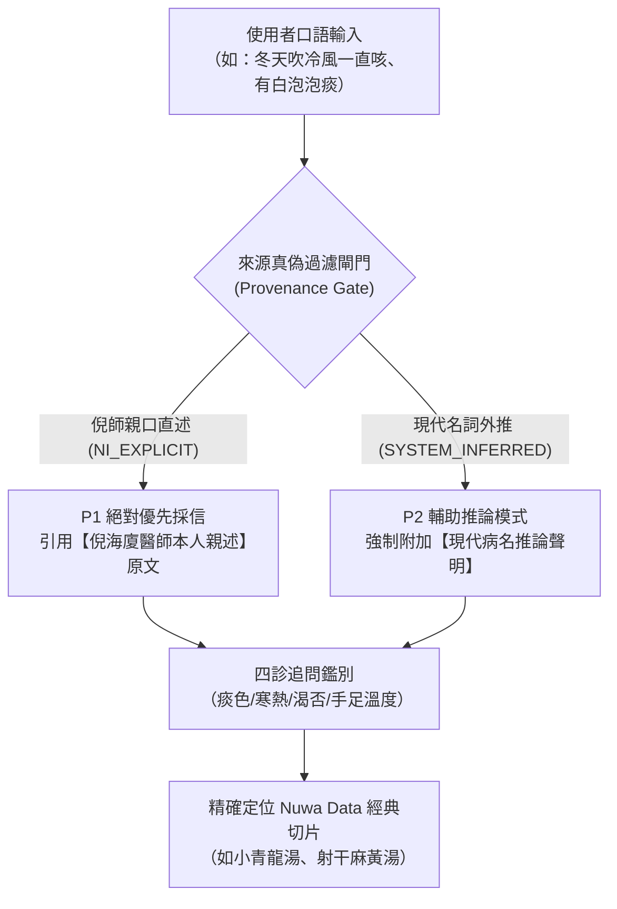

# 🌿 倪海廈經方全集與方證速查指南 (v2.1 雙軌防偽與全域旗艦版)

> **核心原則與防偽保證**：
> 本語料庫與中繼索引嚴格區分 **【倪師親述直接對照 (NI_EXPLICIT_VERIFIED)】** 與 **【現代推論對照 (SYSTEM_INFERRED_EXTRAPOLATION)】**。
> 凡涉及處方判定與病機引用，以倪海廈醫師本人親口講述實錄（人紀、文集、日誌、心法）為 **P1 唯一最高權威**，嚴防 AI 幻覺或後世醫家觀點混入！

---

## 🏛️ 全域語料庫典籍分佈（共 7 大部類、68 個語意切片，315 萬字實錄）

| 部類目錄 | 典籍名稱與性質 | 切片數量 | 核心收錄內容 | 權威層級 |
| :--- | :--- | :---: | :--- | :---: |
| **01_金匱要略** | 東漢·張仲景 原著 / 倪海廈 人紀講義 | 25 卷 | 內傷雜病、婦人三篇、痰飲、消渴、歷節、奔豚 | `NI_DIRECT` |
| **02_傷寒論** | 東漢·張仲景 原著 / 倪海廈 人紀講義 | 9 篇 | 六經辨證（太陽三篇、陽明、少陽、太陰、少陰、厥陰） | `NI_DIRECT` |
| **03_黃帝內經** | 素問靈樞 / 倪海廈 人紀逐篇剖析實錄 | 10 卷 | 上古天真、四氣調神、生氣通天、陰陽應象、欬論、風痹痿厥 | `NI_DIRECT` |
| **04_神農本草經** | 秦漢古本 / 倪海廈 本草藥性心得全本 | 4 篇 | 上品養命、中品養性、下品攻邪，歷代名家藥徵與用量禁忌 | `NI_DIRECT` |
| **05_針灸教程** | 針灸大成 / 倪海廈 針灸實錄 | 9 篇 | 十二正經、奇經八脈、井滎俞原經合、五行刺法、急救火罐 | `NI_DIRECT` |
| **06_仲景心法與扶陽** | 南寧仲景心法傳講 (倪海廈) + 扶陽講記 | 4 篇 | 經方劑量把握、癌症攻堅時機、三焦少陰傳變、火神重陽理論 | `NI_DIRECT` / `NOTE` |
| **07_漢唐醫案與配方** | 漢唐中醫醫案集、跟診日誌、經典配方與地紀 | 5 篇 | 漢唐 1-100 號成方詳解、弟子門診跟診實錄、重症腫瘤臨床實戰 | `NI_DIRECT` |

---

## 🔍 口語、身體部位、分泌物與西醫病名 ➔ 經方靶向索引（倪師親述最高權威）

### 1. 【呼吸與咳嗽門】（冬季久咳、遇冷咳、白稀泡泡痰）
- **口語症狀**：冬天一直咳嗽、吹冷風就咳、咳好幾個月、吐白稀泡泡痰、透明水樣痰、晚上躺平咳更兇。
- **權威來源**：`NI_EXPLICIT_VERIFIED`（倪師親述，見《金匱第十二篇》）
- **倪師斷言**：非發炎細菌，純為**【心陽不足、肺家伏飲（寒飲）】**！病痰飲者，當以溫藥和之。抗生素大苦大寒，只會使肺寒飲更深！
- **對應方陣**：`小青龍湯`（外寒內飲）、`射干麻黃湯`（咳而上氣喉中水雞聲）、`厚朴麻黃湯`、`苓甘五味薑辛夏杏湯`。
- **切片定位**：`01_金匱要略/chunks/12_痰飲咳嗽病脈證治第十二.md`

### 2. 【消化與胃酸門】（胃食道逆流、火燒心、心口堵）
- **口語症狀**：火燒心、胃食道逆流、心口窩脹悶、打嗝打不停、噯氣泛酸。
- **權威來源**：`NI_EXPLICIT_VERIFIED`（倪師親述，見《傷寒論下篇》）
- **倪師斷言**：心下痞滿、濁氣上逆。乃心火小腸熱力不足，胃幽門蒸化無力。制酸劑越吃胃越爛。
- **對應方陣**：`旋覆代赭湯`（噫氣不除）、`半夏瀉心湯`（心下痞滿寒熱錯雜）、`茯苓飲`。
- **切片定位**：`02_傷寒論/chunks/03_太陽病下篇_陷胸瀉心與蓄血證.md`

### 3. 【排泄與下利門】（便秘拉水、熱結旁流重大鑑別）
- **口語症狀**：拉肚子拉水、吃什麼拉什麼 vs 肚子劇痛但一直拉臭水。
- **權威來源**：`NI_EXPLICIT_VERIFIED`（倪師親述，見《傷寒論陽明篇》）
- **倪師斷言**：大便拉水嚴禁見利止利！若是手腳冰冷、下利清稀無臭 ➔ **太陰虛寒**（理中/四逆湯）；若是肚子硬痛拒按、口渴大飲冰水、下利惡臭稀水 ➔ **陽明熱結旁流**（大承氣湯攻下）！
- **切片定位**：`02_傷寒論/chunks/04_陽明病篇_陽明熱證與三承氣湯實證.md`

### 4. 【關節與痛風門】（歷節風、腳大拇趾紅腫熱痛）
- **口語症狀**：痛風、腳踝腫痛、大腳趾關節紅腫像火燒、痛到不能蓋被子。
- **權威來源**：`NI_EXPLICIT_VERIFIED`（倪師親述，見《漢唐文章集錦》）
- **倪師斷言**：即仲景之歷節病。下焦寒濕流注，下肢循環最末梢因寒結晶。
- **對應方陣**：`桂枝芍藥知母湯`（諸肢節疼痛腳腫如脫）、`烏頭湯`（歷節不可屈伸劇痛）。
- **切片定位**：`01_金匱要略/chunks/05_中風歷節病脈證並治第五.md`

### 5. 【心火手足水火門】（健康第一大標準：手足溫熱）
- **口語症狀**：手腳冰冷、夏天也要穿襪子、躲被窩腳還是冰棒。
- **權威來源**：`NI_EXPLICIT_VERIFIED`（倪師親述核心心智模型）
- **倪師斷言**：心陽小腸水火論。常人一年四季手足必溫熱。手足冰冷說明心陽不交小腸，下焦寒濕為癌症與腫瘤之溫床！
- **對應方陣**：`四逆湯`、`當歸四逆湯`、`桂枝加附子湯`。
- **切片定位**：`02_傷寒論/chunks/07_少陰病篇_少陰寒化四逆與死生危候.md`

---

## ⚠️ 系統推論項目使用規範 (SYSTEM_INFERRED_EXTRAPOLATION)
凡檢索涉及「自律神經失調、長新冠、恐慌症、自體免疫抗體」等現代名詞：
1. 系統**不得**宣稱「倪海廈醫師說自律神經失調就是...」。
2. 系統**必須**明示：「倪師講義中未見直接一對一稱呼此病名，依其寒熱虛實與經方病機模型（如奔豚氣、少陽樞機）推論如下，僅供四診鑑別參考。」
